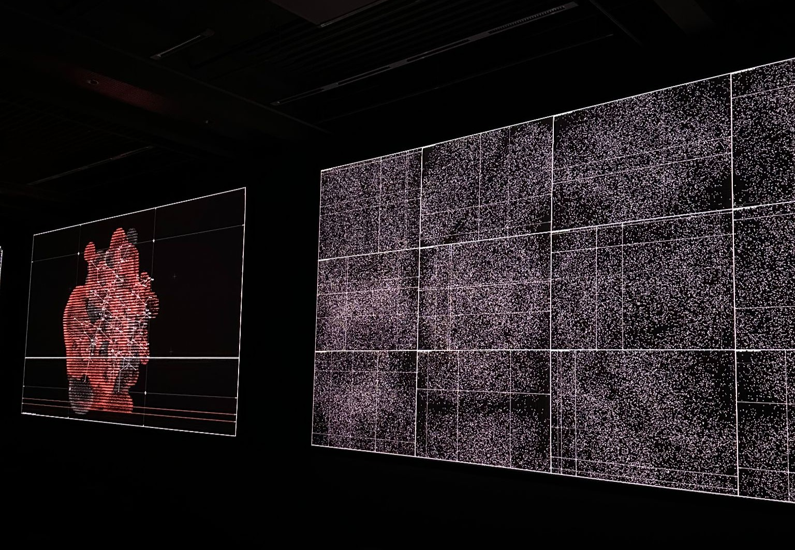

#Data-Visualization

Context: In clinical medicine, physiology is justifiably divided into specialties (cardiology, neurology, endocrinology) and wearable devices similarly present heart rate, respiration, stress, and sleep as separate dashboards and tabs. However, lived experience does not occur separately. Stress, calmness, and emotion are whole-body states borne from interactions between multiple physiological systems. This project explores how biosignals might be represented as an interconnected symbiotic system.

(Ryoji Ikeda exhibition I was inspired by.)